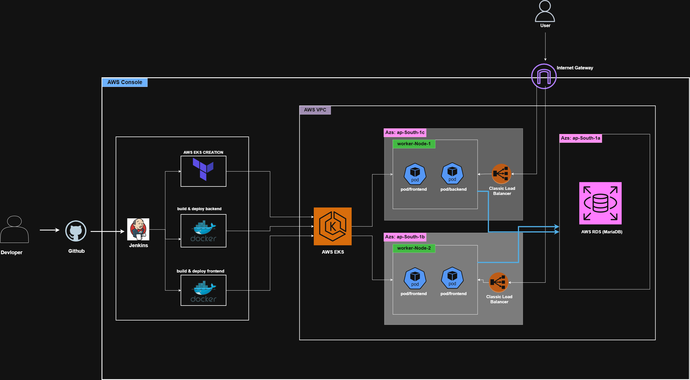

<div align="center">

# 🏗️ 3-Tier College Registration App
### AWS EKS · Jenkins CI/CD · Terraform · Docker · MariaDB


> A production-grade, cloud-native **3-tier web application** for college student registration — containerized with Docker, orchestrated on **AWS EKS**, deployed via automated **Jenkins CI/CD pipelines**, and infrastructure-as-code with **Terraform**.

</div>

---

## 📋 Table of Contents

- [Architecture Overview](#-architecture-overview)
- [Tech Stack](#-tech-stack)
- [Project Structure](#-project-structure)
- [CI/CD Pipelines](#-cicd-pipelines)
- [AWS Infrastructure](#-aws-infrastructure)
- [Kubernetes Workloads](#-kubernetes-workloads)
- [Application UI](#-application-ui)
- [Database Setup](#-database-setup)
- [Local Development](#-local-development-docker-compose)
- [Deployment Guide](#-deployment-guide)
- [Future Improvements](#-future-improvements)

---

## 🏛️ Architecture Overview



> **Traffic Flow:** `Developer` → `GitHub` → `Jenkins` → `Docker Hub` → `AWS EKS` ← `AWS RDS (MariaDB)`  
> `User` → `Internet Gateway` → `Classic Load Balancer` → `Frontend Pod` → `Backend Pod` → `RDS`

| Concern | Solution |
|---|---|
| **High Availability** | EKS across 2 AZs (`ap-south-1b`, `ap-south-1c`) |
| **Scalability** | Node group auto-scales 1–3 × `c7i-flex.large` |
| **Pipeline Separation** | 3 independent Jenkins pipelines (infra / backend / frontend) |
| **Managed Database** | AWS RDS MariaDB (`db.t4g.micro`) in `ap-south-1a` |
| **Container Registry** | Docker Hub (`abhishekakurhade/3tier-*`) |

---

## 🛠️ Tech Stack

| Layer | Technology | Version / Details |
|---|---|---|
| **Frontend** | React + Vite + Apache httpd | React 18, served on port 80 |
| **Backend** | Spring Boot + Spring Data JPA | Java 17, port 8080 |
| **Database** | MariaDB on AWS RDS | `db.t4g.micro`, `ap-south-1a` |
| **Containerization** | Docker (multi-stage builds) | Hub: `abhishekakurhade` |
| **Orchestration** | AWS EKS (Kubernetes) | Cluster: `my-cluster` |
| **IaC** | Terraform | EKS cluster + node group |
| **CI/CD** | Jenkins | 3 declarative pipelines |
| **Build Tool** | Maven (backend) / npm + Vite (frontend) | — |

---

## 📁 Project Structure

```
3tier/
├── 📄 main.tf                          # Terraform — EKS cluster + IAM + node group
├── 📄 compose.yml                      # Docker Compose for local development
├── 📄 DB_README.md                     # MariaDB setup & schema guide
├── 📁 docs/images/                     # Screenshots & diagrams (this README)
│
├── 📁 backend/                         # Spring Boot REST API
│   ├── dockerfile                      # Multi-stage: Maven builder → JRE Alpine
│   ├── pom.xml                         # Spring Boot 3.3.5, JPA, MariaDB, Lombok
│   ├── backend-pod.yaml                # K8s Pod manifest
│   ├── backend-svc.yaml                # K8s Service (LoadBalancer :8080)
│   └── src/main/
│       ├── java/com/student/registration/
│       │   ├── controller/             # REST endpoints
│       │   ├── model/                  # Student JPA entity
│       │   └── repository/             # Spring Data repository
│       └── resources/
│           └── application.properties  # DB datasource config
│
└── 📁 frontend/                        # React + Vite SPA
    ├── dockerfile                      # Node build → Apache httpd (Alpine)
    ├── frontend-deploy.yml             # K8s Deployment (3 replicas)
    ├── frontend-svc.yml                # K8s Service (LoadBalancer :80)
    ├── package.json                    # React 18, Axios, React Router
    └── src/
        ├── components/
        │   ├── RegistrationForm.jsx    # Main registration UI
        │   └── Modal.jsx
        ├── api/userService.js          # Axios API calls to backend
        ├── hooks/useRegistrationForm.js
        └── App.jsx
```

---

## 🔄 CI/CD Pipelines

Three Jenkins pipelines cover the full deployment lifecycle — **infrastructure → backend → frontend**.

---

### Pipeline 1 — `k8s-infra` (Terraform · EKS Provisioning)


| Stage | What It Does | Avg Time |
|---|---|---|
| `clone code` | Clones GitHub repo to Jenkins agent | ~3s |
| `create k8s` | Runs `terraform init` + `terraform apply` to provision EKS | ~8m 58s |

```
✅  Build #2  —  SUCCESS   Nov 25, 21:38  (Full run: ~9 min 1s)
❌  Build #1  —  FAILED    Nov 25, 21:36
```

---

### Pipeline 2 — `project-backend` (Spring Boot · Docker · EKS Deploy)


| Stage | What It Does | Avg Time |
|---|---|---|
| `clone` | Clones repository | ~2s |
| `build image` | `docker build` — Maven compiles & packages JAR, copies into JRE image | ~37s |
| `push on docker` | `docker push` to Docker Hub (`abhishekakurhade/3tier-backend`) | ~5s |
| `deploy on eks` | `kubectl apply` backend Pod + Service to EKS | ~2s |

```
✅  Build #5  —  SUCCESS   Nov 25, 17:51  (Full run: ~58s)
❌  Build #4  —  FAILED    Nov 25, 17:12  ← push & deploy stages failed
✅  Build #3  —  SUCCESS   Nov 25, 15:09
✅  Build #2  —  SUCCESS   Nov 25, 16:56
❌  Build #1  —  FAILED    Nov 25, 22:25
```

---

### Pipeline 3 — `project-frontend` (React · Docker · EKS Deploy)


| Stage | What It Does | Avg Time |
|---|---|---|
| `clone` | Clones repository | ~1s |
| `build image` | `npm install && npm run build` → copies `dist/` into Apache htdocs | ~23s |
| `push on docker` | `docker push` to Docker Hub (`abhishekakurhade/3tier-frontend`) | ~10s |
| `deploy on eks` | `kubectl apply` frontend Deployment (3 replicas) + Service | ~13s |

```
✅  Build #1  —  SUCCESS   Nov 25, 23:34  (Full run: ~49s)
```

> **Total deployment time** (after EKS is live): ~58s backend + ~49s frontend = **under 2 minutes end-to-end.**

---

## ☁️ AWS Infrastructure

### EC2 Instances


| Instance Name | Instance ID | Type | AZ | Role |
|---|---|---|---|---|
| `worker-node1` | `i-0df9ba83d94b52c1c` | `c7i-flex.large` | `ap-south-1c` | EKS Worker Node |
| `worker-node2` | `i-0be66aebcfad34eb8` | `c7i-flex.large` | `ap-south-1b` | EKS Worker Node |
| `k8s-agent` | `i-0be1c23ed9a03df7` | `m7i.flex.large` | `ap-south-1a` | Jenkins Agent (kubectl) |
| `jenkins` | `i-04eeef9488dd1148e` | `c7i.large` | `ap-south-1a` | Jenkins Master |

---

### EKS Cluster — `my-cluster`


| Property | Value |
|---|---|
| **Cluster Name** | `my-cluster` |
| **Region** | `ap-south-1` (Mumbai) |
| **Node Group** | `cluster-nodegroup` |
| **Instance Type** | `c7i-flex.large` |
| **AMI** | `AL2023_x86_64_STANDARD` |
| **Capacity Type** | On-Demand |
| **Node Scaling** | Min: 1 / Desired: 2 / Max: 3 |
| **Disk per Node** | 20 GB |
| **Node Health** | ✅ 0 issues |

| Node | CPU Usage | Status |
|---|---|---|
| `ip-172-31-11-20.ap-south-1.compute.internal` | 22% | ✅ Ready |
| `ip-172-31-29-173.ap-south-1.compute.internal` | 12% | ✅ Ready |

---

### RDS — `database-10` (MariaDB)


| Property | Value |
|---|---|
| **DB Identifier** | `database-10` |
| **Engine** | MariaDB |
| **Instance Class** | `db.t4g.micro` |
| **Region / AZ** | `ap-south-1a` |
| **Status** | ✅ Available |
| **Active Connections** | ~10 |
| **Internet Access** | ❌ Disabled (VPC-private only) |
| **IAM Auth** | ❌ Disabled |

---

## ☸️ Kubernetes Workloads


```bash
$ kubectl get all

NAME                                     READY   STATUS    RESTARTS   AGE
pod/backend                              1/1     Running   0          13h
pod/frontend-74cc86b849-cbz6f            1/1     Running   0          13h
pod/frontend-74cc86b849-hg2n6            1/1     Running   0          13h
pod/frontend-74cc86b849-nqb51            1/1     Running   0          13h

NAME                   TYPE           CLUSTER-IP       EXTERNAL-IP                                              PORT(S)
service/backend-svc    LoadBalancer   10.100.232.178   a7ebf77597c724e...ap-south-1.elb.amazonaws.com          8080:31939/TCP
service/frontend-svc   LoadBalancer   10.100.150.34    a76279fbdb9204e...ap-south-1.elb.amazonaws.com          80:30322/TCP
service/kubernetes     ClusterIP      10.100.0.1       <none>                                                   443/TCP

NAME                       READY   UP-TO-DATE   AVAILABLE
deployment.apps/frontend   3/3     3            3

NAME                                  DESIRED   CURRENT   READY
replicaset.apps/frontend-74cc86b849   3         3         3
```

---

## 🖥️ Application UI


The deployed application is a **College Student Registration System**.

**Form Fields:** Name · Email · Course · Highest Education · Percentage · Branch or Stream · Mobile Number

**Features:**
- ➕ Register new students (POST → Spring Boot → MariaDB)
- 📋 View all registered students in a live table
- 🗑️ Delete student records

**Live Frontend URL:**
```
http://a76279fbdb9204e6aa43a0c1907ff649-953289300.ap-south-1.elb.amazonaws.com
```

**Live Backend API URL:**
```
http://a7ebf77597c724e89898d2dc14f03571-2068772430.ap-south-1.elb.amazonaws.com:8080
```

---

## 🗄️ Database Setup

> See [DB_README.md](DB_README.md) for the full MariaDB installation guide.

**Database name:** `student_db`

### Create the Schema

```sql
USE student_db;

CREATE TABLE `students` (
  `id`             bigint(20)   NOT NULL AUTO_INCREMENT,
  `name`           varchar(255) DEFAULT NULL,
  `email`          varchar(255) DEFAULT NULL,
  `course`         varchar(255) DEFAULT NULL,
  `student_class`  varchar(255) DEFAULT NULL,
  `percentage`     double       DEFAULT NULL,
  `branch`         varchar(255) DEFAULT NULL,
  `mobile_number`  varchar(255) DEFAULT NULL,
  PRIMARY KEY (`id`)
) ENGINE=InnoDB AUTO_INCREMENT=1 DEFAULT CHARSET=latin1;
```

### Backend DB Config (`application.properties`)

```properties
server.port=8080
spring.datasource.url=jdbc:mariadb://<RDS-ENDPOINT>:3306/student_db?sslMode=trust
spring.datasource.username=<DB_USER>
spring.datasource.password=<DB_PASS>
spring.jpa.hibernate.ddl-auto=update
spring.jpa.show-sql=true
```

> ⚠️ **Never commit real credentials.** Use environment variables or AWS Secrets Manager in production.

---

## 🐳 Local Development (Docker Compose)

```bash
# 1. Clone the repository
git clone https://github.com/<your-username>/3tier.git
cd 3tier

# 2. Start frontend + backend
docker compose up --build

# 3. Access locally
#    Frontend  →  http://localhost
#    Backend   →  http://localhost:8080
```

> **Note:** The compose file does not include a DB container. Run a local MariaDB or point `application.properties` to your RDS endpoint.

---

## 🚀 Deployment Guide

### Prerequisites

| Requirement | Details |
|---|---|
| AWS Account | IAM permissions: EKS, EC2, RDS, IAM |
| Terraform ≥ 1.x | Installed on Jenkins agent |
| kubectl | Installed & configured on Jenkins agent |
| AWS CLI | Configured with `ap-south-1` profile |
| Jenkins | Pipeline + Docker plugins installed |
| Docker Hub | Account with `abhishekakurhade/3tier-*` repos created |

---

### Step 1 — Set Up Jenkins

```bash
# Install Jenkins on EC2 (Ubuntu)
sudo apt update && sudo apt install -y openjdk-17-jdk
wget -q -O - https://pkg.jenkins.io/debian/jenkins.io.key | sudo apt-key add -
sudo sh -c 'echo deb http://pkg.jenkins.io/debian-stable binary/ > /etc/apt/sources.list.d/jenkins.list'
sudo apt update && sudo apt install -y jenkins
sudo systemctl start jenkins && sudo systemctl enable jenkins

# Install Docker on Jenkins agent
sudo apt install -y docker.io
sudo usermod -aG docker jenkins
```

Configure Jenkins credentials:
- `dockerhub-creds` — Docker Hub username + password
- `aws-creds` — AWS Access Key + Secret Key
- `kubeconfig` — base64-encoded `~/.kube/config` from EKS

---

### Step 2 — Provision EKS with Terraform (`k8s-infra` pipeline)

```

**What Terraform creates:**
- IAM role `eks-role` + `AmazonEKSClusterPolicy` attachment
- IAM role `eks-node-role` + Worker/CNI/ECR policy attachments
- EKS cluster `my-cluster` using the default VPC subnets
- Managed node group `cluster-nodegroup` — 2× `c7i-flex.large` On-Demand, 20 GB disk

```bash
# After apply — configure kubectl
aws eks update-kubeconfig --region ap-south-1 --name my-cluster
kubectl get nodes   # Both nodes should show STATUS=Ready
```

---

### Step 3 —  RDS (MariaDB)

1. Go to **AWS Console → RDS → Create Database**
2. Select **MariaDB**, instance class `db.t4g.micro`
3. Set DB identifier: `database-10`, DB name: `student_db`
4. Place it in **`ap-south-1a`**, in the same VPC as EKS
5. Create a **Security Group** allowing port `3306` from EKS worker node SG
6. Copy the **endpoint** and update `backend/src/main/resources/application.properties`


---

### Step 4 — Deploy Backend (`project-backend` pipeline)

**Jenkins Jenkinsfile stages:**


---

### Step 5 — Deploy Frontend (`project-frontend` pipeline)

**Jenkins Jenkinsfile stages:**


## 🔮 Future Improvements

| Item | Description |
|---|---|
| **Helm Charts** | Package K8s manifests for versioned, parameterized releases |
| **Ingress + TLS** | NGINX/ALB Ingress + ACM certificates for HTTPS |
| **Kubernetes Secrets** | Move DB credentials out of `application.properties` |
| **Backend Deployment** | Convert backend Pod → Deployment for HPA & rolling updates |
| **HPA** | Horizontal Pod Autoscaler based on CPU/memory |
| **Monitoring** | Prometheus + Grafana + CloudWatch alarms |
| **Multi-env** | Separate `dev` / `staging` / `prod` K8s namespaces |
| **GitHub Actions** | PR-level CI checks alongside Jenkins |

---

<div align="center">

**Made with ❤️ by Abhishek Kurhade**


</div>
